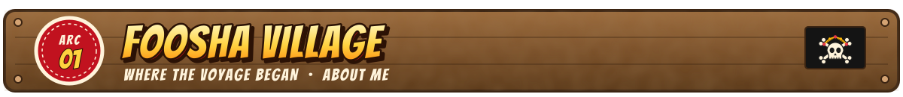
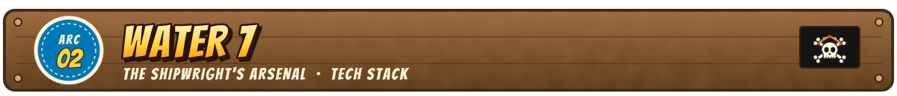
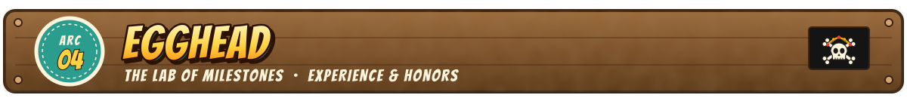
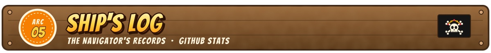

<!-- ⚓ One Piece-inspired fan theme · every illustration in /assets is original artwork -->

🧭 <b>LOG POSE</b> →
<a href="#foosha">Foosha</a> ·
<a href="#water7">Water 7</a> ·
<a href="#skypiea">Skypiea</a> ·
<a href="#egghead">Egghead</a> ·
<a href="#shipslog">Ship's Log</a> ·
<a href="#newworld">New World</a>

  

### 🏴‍☠️ Pirate Profile

| | |
|---|---|
| 👒 **Name** | Farhan Aaqil Durrani |
| ⚔️ **Epithet** | *"The Agent Shipwright"* |
| 🚢 **Crew** | Captain of the **Neural Pirates** · AI Engineer Intern @ **Sydney Leads** |
| 🍎 **Devil Fruit** | *Agento Agento no Mi*: spawns, routes and orchestrates AI agents at will |
| 🌀 **Haki** | 👁️ Observation: evals & benchmarks 🛡️ Armament: sandboxes & approval gates 👑 Conqueror's: shipping to production |
| 🏝️ **Home sea** | Mahbubnagar, India · sails remote |
| 🎓 **Training** | Final-year B.Tech AI/ML, JPNCE |
| 💭 **Dream** | Build AI systems people can actually trust |

**Wanted for:** 15 projects built · 1 published paper · 2 hackathon wins · 8 certifications · 1,100+ commits in a year

> *"Ideas into systems. Curiosity into craft."* I build the bridge between an idea and a system people can use: **LLM agents, RAG pipelines and scalable backends**, shipped end to end instead of left in a notebook.

<table>
  <tr>
    <td align="center" width="200"><b>🐌 Den Den Mushi</b> languages I speak</td>
    <td></td>
  </tr>
  <tr>
    <td align="center"><b>🍎 Devil Fruits</b> machine learning</td>
    <td></td>
  </tr>
  <tr>
    <td align="center"><b>🌀 Haki</b> GenAI & agents</td>
    <td>
      
      
      
      
      
      
      
      
    </td>
  </tr>
  <tr>
    <td align="center"><b>⛵ Hull & Sails</b> backend & frontend</td>
    <td></td>
  </tr>
  <tr>
    <td align="center"><b>💰 Treasure Vaults</b> data & databases</td>
    <td></td>
  </tr>
  <tr>
    <td align="center"><b>⚓ Shipyards</b> infra & tools</td>
    <td></td>
  </tr>
  <tr>
    <td align="center"><b>🔆 Dials</b> hardware</td>
    <td></td>
  </tr>
</table>

<table>
  <tr>
    <td width="50%" valign="top">
      <h3>🏝️ 02 · <a href="https://github.com/FarhanAaqil/GateOrchestra">GateOrchestra</a></h3>
      
      
A trainable gate in front of a multi-agent orchestrator that decides, <i>before</i> setting sail, whether a query needs a cheap single-agent probe or the whole fleet.

      
      
      
       <code>Python</code> <code>Multi-Agent</code> <code>CoT-SC</code> <code>Qwen2.5</code> <code>Groq</code> <code>React</code>
    </td>
    <td width="50%" valign="top">
      <h3>🏝️ 03 · <a href="https://github.com/FarhanAaqil/Autonomous-Orchestrator-Agent">Autonomous Orchestrator Agent</a></h3>
      
      
A nine-agent crew with an HMAC-signed human approval gate that can't be bypassed, payload-hash binding, crash-resilient autonomy, sandboxed browsing and multi-tier memory.

      
      
      
       <code>FastAPI</code> <code>SQLite</code> <code>ChromaDB</code> <code>React 18</code> <code>SSE</code> <code>Docker</code>
    </td>
  </tr>
  <tr>
    <td width="50%" valign="top">
      <h3>🏝️ 04 · <a href="https://github.com/FarhanAaqil/self-improving-agent">Self-Improving Code Agent</a></h3>
      
      
Writes Python, runs it in an isolated read-only container, critiques its own tracebacks and repairs the code. It remembers failure patterns in ChromaDB, and verified runs earn a certificate.

      
      
       <code>Groq</code> <code>Llama 3.3 70B</code> <code>FastAPI</code> <code>React 19</code> <code>Docker</code> <code>ChromaDB</code>
    </td>
    <td width="50%" valign="top">
      <h3>🏝️ 05 · <a href="https://github.com/FarhanAaqil/NebulaLM">NebulaLM</a></h3>
      
      
A space and astronomy language model built from the tokenizer up, plus a pre-registered study of how 4.5M to 29M parameter models learn, store and leak data. Rejected hypotheses are reported too.

      
      
      
       <code>PyTorch</code> <code>Transformer</code> <code>Byte-level BPE</code>
    </td>
  </tr>
  <tr>
    <td colspan="2" valign="top">
      <h3>🏰 06 · <a href="https://github.com/FarhanAaqil/Visentra">Visentra</a></h3>
      
      
A forensic workstation for computer-vision supply chains. It links hashes, Merkle roots and Ed25519 signatures to behavioural checks on a lineage graph, covering dataset integrity, model integrity, backdoor screening and inference binding.

      <code>Python</code> <code>FastAPI</code> <code>Computer Vision</code> <code>Ed25519 / Merkle</code> <code>React 19</code> <code>Three.js</code>
    </td>
  </tr>
</table>

<b>🗺️ More islands in the Log Pose (10 more projects)</b>

 

| Island | What it does | Status | Links |
|---|---|---|---|
| 📊 **SheetSense AI** | Conversational agent over live Google Sheets, with RAG schema retrieval and a write-confirmation gate |  | [repo](https://github.com/FarhanAaqil/Sheet-AI) |
| 🖥️ **LemonHost Monitor** | Workforce operations platform with a Chrome extension for clock-in monitoring |  | [repo](https://github.com/farhansldm/LC-Monitor) |
| 📈 **SLDM SEO** | SEO agency platform with background job queues |  | [repo](https://github.com/farhansldm/SLDM-seo) |
| 🍵 **Adore Tea** | QR table ordering for a restaurant |  | private |
| 🧪 **GenAI Lab** | Browser platform with 14 modules, CodeMirror and a streaming AI mentor |  | [repo](https://github.com/FarhanAaqil/genai-lab) · [live](https://genai-lab-psi.vercel.app) |
| 🎤 **InterviewPro** | AI interview prep built on the Claude API |  | [repo](https://github.com/FarhanAaqil/interviewpro) · [live](https://claude.ai/public/artifacts/367d3360-5eab-4ff9-afe4-73b7c3050802) |
| 🌲 **Samisthi Aranya Resort** | Website for a forest-edge resort near the Nallamala hills |  | [repo](https://github.com/FarhanAaqil/Samisthi-Aranya-Resort) · [live](https://samisthiaranyaresort.vercel.app) |
| 🚑 **CrisisRoute** | Post-disaster relief logistics decision support with a second-person sign-off |  | [repo](https://github.com/FarhanAaqil/Crisis-Route) |
| 🩹 **PatchGraph** | Explainable supply-chain remediation that recommends but never auto-patches |  | [repo](https://github.com/FarhanAaqil/PatchGraph) |
| 🌊 **AquaSphere** | Satellite embeddings that reconstruct 0–1000 m ocean temperature profiles, validated on ARGO floats |  | [repo](https://github.com/FarhanAaqil/AquaSphere) |

### ⛵ Crews I've Sailed With

<table>
  <tr>
    <td width="210" valign="top"></td>
    <td valign="top">
      <b>🏢 AI Engineer Intern</b> · Sydney Leads Digital Marketing · <i>Remote</i> 
      Building AI-powered applications, automation and LLM/ML solutions, plus AI-assisted website development and deployment.
    </td>
  </tr>
  <tr>
    <td valign="top"></td>
    <td valign="top">
      <b>⚙️ Python Full Stack Developer & AIML Intern (Tech Lead)</b> · Jala Academy · <i>Remote</i> 
      Took ML projects from preprocessing through training, evaluation and deployment, built full-stack features, and coordinated and mentored trainees.
    </td>
  </tr>
</table>

### 💰 Bounty Raised

| | |
|---|---|
| 🥇 | **1st place**, Internal Smart India Hackathon **2026** (with Visentra) |
| 🥇 | **1st place**, Internal Smart India Hackathon **2025** |
| 📚 | **XERJ Corpus Hub contributor** (Oct 2026): Autonomous Orchestrator Agent selected as reference memory that AI coding agents search before writing code |

### 📜 Poneglyph Deciphered

**Diabetes Prediction System Using Machine Learning**: *Journal of Advancement in Parallel Computing*, Vol. 08, Issue 02, HBRP Publication, 2025. 
Ensemble learning (Random Forest, XGBoost, Gradient Boosting) on the PIMA dataset, with feature-importance analysis and clinical threshold tuning.

### 🌀 Haki Training Certificates

  
  
  
  
   
  
  
  
  

### 🏴‍☠️ Looking for my next crew!

**Currently building AI solutions at Sydney Leads, and open to remote AI/ML internships and junior roles.** 
If you're building agents, LLM tooling or anything intelligent, send a Den Den Mushi call. 🐌

